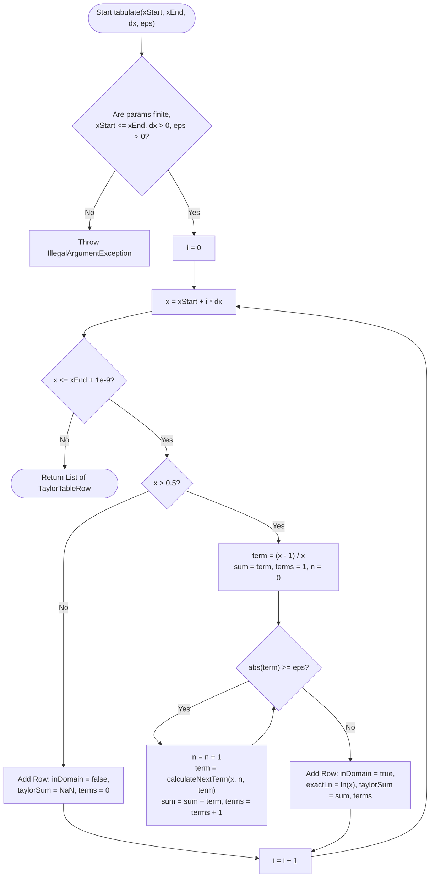
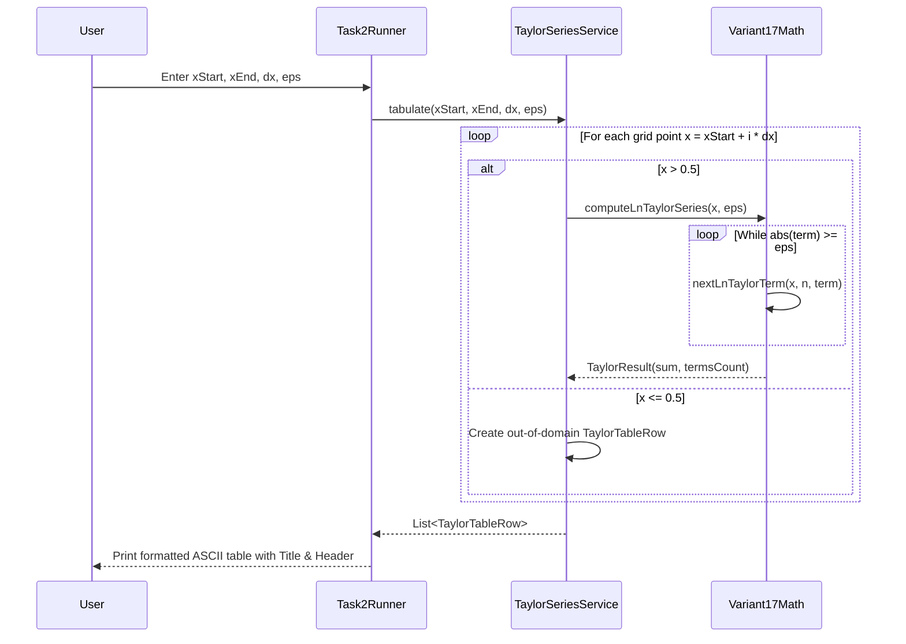
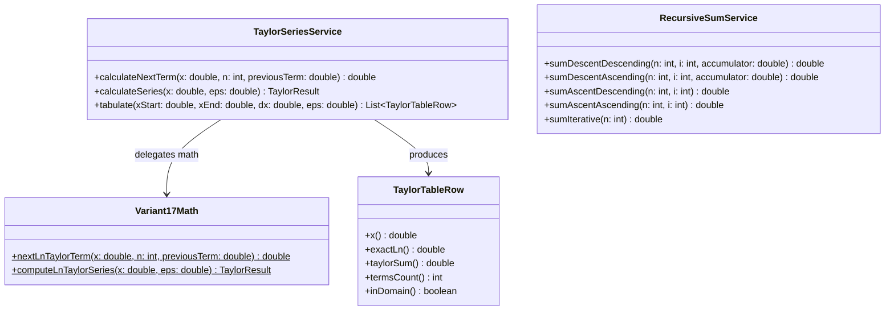

# Lab 5: Modular Functions, Recurrent Relations, and Recursion (Variant 17)

## 1. Overview
This laboratory module implements modular decomposition, recurrent Taylor series tabulation, piecewise functions, and recursion for **Variant 17**:

- **Task 5.1 (`task1`):** Composite rational expression evaluation using a reusable helper function $h(x, y, z) = \frac{x^2 + y^2 + z^2}{x + y + z}$:
  $$f(a, b) = \frac{h(a, b, 1) + h(1, a, b)}{1 + h(a^2 + b^2, 1, 0)}$$
- **Task 5.2 (`task2`):** Tabulation of $\ln(x)$ via its Taylor series on $[x_{\text{start}}, x_{\text{end}}]$ with step $dx$ and accuracy $\varepsilon$:
  $$\ln x = \sum_{n=0}^{\infty} \frac{(x-1)^{n+1}}{(n+1)\cdot x^{n+1}}, \quad x > \frac{1}{2}$$
  Using the recurrent relation:
  $$a_0 = \frac{x-1}{x}, \qquad a_n = a_{n-1} \cdot \frac{n(x-1)}{(n+1)x}$$
- **Task 5.3 (`task3`):** Tabulation of the composite expression $Q(g) = z(2g + 1) - z^2(2g - 1) + \sqrt{z(g)}$ where $z(x)$ is a piecewise function switching between an analytical expression ($|x| \ge 1$) and a 7-term recurrent power series ($|x| < 1$).
- **Task 5.4 (`task4`):** Evaluation of the finite trigonometric sum in 5 ways (4 recursive strategies + 1 iterative benchmark):
  $$S = \sum_{i=1}^{N} \frac{\sin i}{1 + \cos i}$$
- **Task 5.5 (`task5`):** Recursive computation of the $n$-th term and partial sum of a geometric progression $b_n = b_1 \cdot q^{n-1}$ while tracking recursion level and maximum call-stack depth.

## 2. Execution Guide
```bash
# Run all unit tests in common-utils, lb4, and lb5
./mvnw test -pl common-utils,lb4,lb5
```

## 3. Architecture & Algorithm Diagrams

### Flowchart: Task 5.2 Recurrent Taylor Series Tabulation


### Sequence Diagram: Task 5.2 UI-to-Service-to-Math Delegation


### Class Diagram: Module `lb5` Structure

