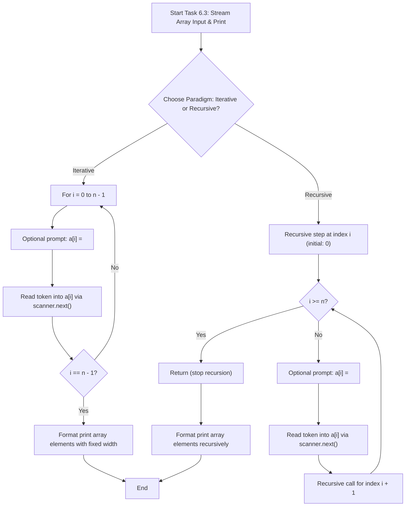
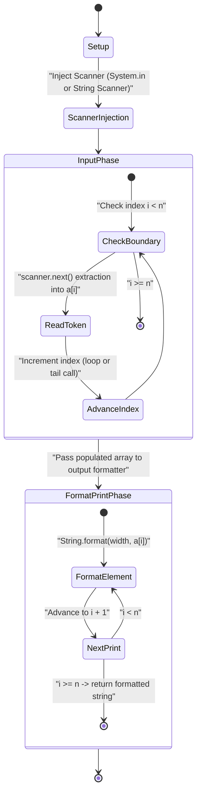
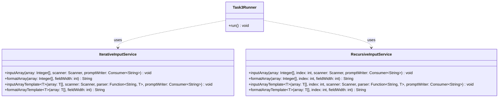

# Lab 6: One-Dimensional Arrays (Java)

This module provides modular implementations of 1D array operations, contrasting iterative loops with pure recursive algorithms.

## 1. Subtasks Overview

1. **Task 6.1 (Variant 17): Array Selection, Counting, Summing, and Zeroing**
   - **Data Domain:** 25 integer elements uniformly distributed in $[4, 73]$.
   - **Selection Criterion:** $(r_i \bmod 6 = 0) \lor (i \bmod 5 \neq 0)$.
   - **Invariants:**
     - Matching count: $20 \le K \le 25$.
     - Cumulative sum: $80 \le S \le 1825$.
     - Call sequence: $\text{Generate} \to \text{Print} \to (\text{Count}, \text{Sum}) \to \text{Zero} \to \text{Print}$.
   - **Decomposition:** Single-responsibility methods across `IterativeArrayService` and `RecursiveArrayService` (`generate`, `formatArray`, `countElements`, `sumElements`, `zeroElements`).

2. **Task 6.2 (Variant 17): Search for the Index of the Maximum Even Element**
   - **Data Domain:** One-dimensional array $a = (a_0, \dots, a_{n-1})$ with $a_i \in [-50, 50]$.
   - **Mathematical Model:**
     - Parity predicate: $P(x) \iff (x \bmod 2 = 0)$ (0 and negative evens are included).
     - Missing even elements ($I_{\text{even}} = \varnothing$): returns sentinel value $-1$.
     - Duplicate maximum even values: returns the index of the first occurrence: $k^* = \min \{ i \in I_{\text{even}} \mid a_i = M \}$.
   - **Decomposition:** `generate`, `formatArray`, `findMaxEvenIndex` in `IterativeMaxEvenService` and `RecursiveMaxEvenService`.

3. **Task 6.3: Stream & Keyboard Array Input with Ordinary and Generic/Template Functions**
   - **Data Domain:** Sequential population and formatted output of 1D arrays of size $n$ via `Scanner` / input streams.
   - **Dual Typification:**
     - **Part A (Ordinary Functions):** Type-specialized for `Integer`: `inputArray`, `formatArray` (iterative and recursive).
     - **Part B (Generic Functions):** Parametric polymorphism for generic type `T` (`Integer`, `Double`, `String`): `inputArrayTemplate`, `formatArrayTemplate` (iterative and recursive).
   - **Deterministic Testing:** Fully decoupled from interactive standard input via injected `Scanner` instances over `String` streams.

4. **Task 6.4:** Dynamic array manipulation: positive count, sum after last zero, and stable partition around value $2.0$.

## 2. Compilation and Execution

```bash
# Build and run tests
./mvnw clean test -pl lb6

# Run interactive console application
./mvnw compile exec:java -pl lb6 -Dexec.mainClass="com.lpnu.lb6.ui.Main"
```

## 3. Diagrams (Mermaid.js)

### Flowchart (`flowchart TD`)



### Activity / State Diagram (`stateDiagram-v2`)



### Class Diagram (`classDiagram`)


